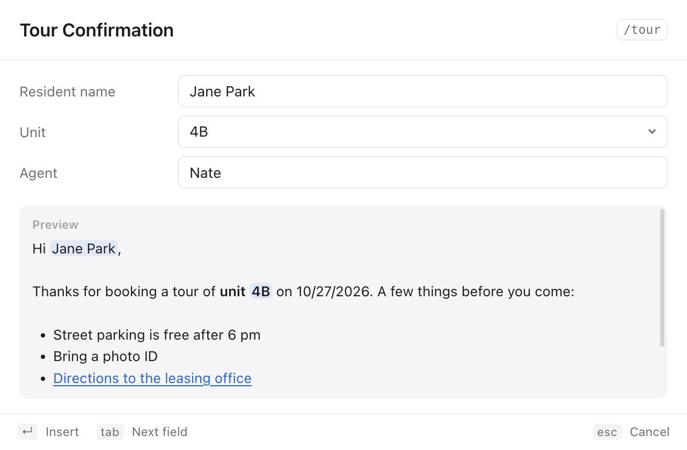
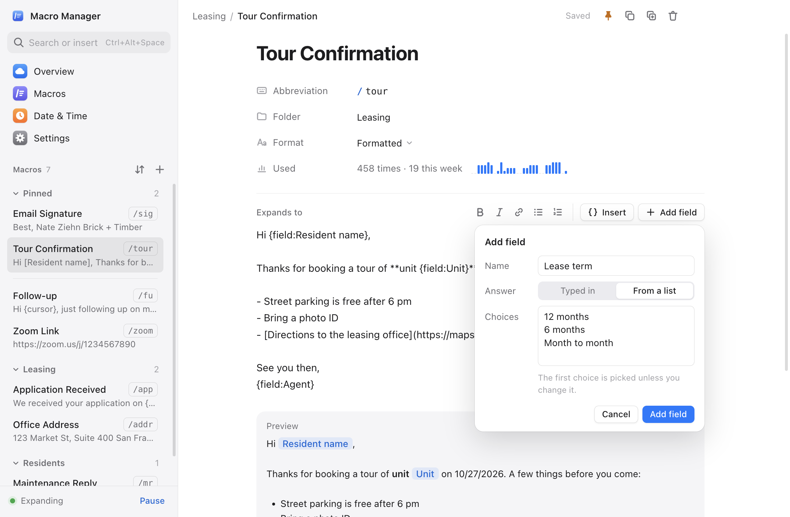

<p align="center">
  
</p>

<h1 align="center">Macro Manager</h1>

<p align="center">
  Type a short abbreviation anywhere and it expands into your saved text, in every app, on Mac and Windows.<br/>
  Built for and used daily by my team at Brick + Timber.
</p>

<p align="center">
  <a href="https://github.com/throughnateseyes/macro-manager/releases/latest/download/Macro-Manager-Windows-Setup.exe"><b>Download for Windows</b></a> ·
  <a href="https://github.com/throughnateseyes/macro-manager/releases/latest/download/Macro-Manager-Mac-arm64.dmg"><b>Mac (Apple Silicon)</b></a> ·
  <a href="https://github.com/throughnateseyes/macro-manager/releases/latest/download/Macro-Manager-Mac-x64.dmg"><b>Mac (Intel)</b></a>
</p>


## What it does

Type `/sig` then Space, and it becomes your full email signature. Type `/tour` and a tour confirmation appears with the date already filled in. It works in Outlook, Teams, Chrome, Slack, Excel: anywhere you can type.

| | |
|---|---|
|  |  |
| **Notion-style editor** with formatting, fill-in fields, and live preview | **Quick Insert**: search every macro from any app and paste it |
|  |  |
| **Fill-in fields**: type `/tour`, fill in the name and unit, press Enter | **Add a field** while you write: typed in, or picked from a list |
|  |  |
| **Native on Windows** with theme-matched title bar controls | **Tray flyout**: today's count, streak, and one-click copy |

### Features

- **System-wide expansion**: `prefix + abbreviation`, then Space, Tab, or Enter
- **Formatting that survives the paste**: bold, italics, links and lists land formatted in Outlook, Zendesk, Gmail, Teams and Word, and as clean text in terminals and Excel. Nothing to switch
- **Fill-in fields**: `{field:Resident name}` asks for a name, a unit or anything else when the macro expands, with defaults and pick-lists
- **Smart placeholders**: `{cursor}` `{clipboard}` `{date}` `{date+7}` `{time}` `{day}` `{weekday}` and more
- **Quick Insert**: `⌘⇧Space` on Mac, `Ctrl+Alt+Space` on Windows. One shortcut everywhere, including the search box inside the app, with Pinned and Recent at the top
- **Macros library**: every macro as a card, with what it types, how often it's used and when, grouped by Pinned, Recent and folder
- **Stats that make it a habit**: lifetime expansions, day streaks, milestones, an activity heatmap, and typing time saved
- **Pinned macros** in the tray or menu bar for one-click copy
- **Folders, search, and sorting**, all keyboard-driven
- **Safe by default**: atomic saves, 14 days of daily backups, and recovery from a corrupt file
- **Updates itself** on Windows. Mac shows a one-click download.
- **Light, dark, or system** theme, with native vibrancy on macOS

### Built-in date and time

| Type | Gets |
|---|---|
| `/ts` | October 24, 2026 2:30 PM |
| `/date` | 10/24/2026 |
| `/isodate` | 2026-10-24 |
| `/time` | 2:30 PM |
| `/time24` | 14:30:00 |
| `/day` | Saturday, October 24 |
| `/unix` | 1792880000 |

### Formatting and fill-in fields

Set a macro's **Format** to Formatted (or just press ⌘B / Ctrl+B in it) and write:

| Write | Pastes as |
|---|---|
| `**bold**`, `*italic*` | **bold**, *italic* |
| `[Directions](https://…)` | a link (in plain-text apps: Directions (https://…)) |
| `- item`, `1. item` | a bulleted or numbered list |

**Add field** puts `{field:Name}` where your cursor is. When you type the abbreviation, a small window asks for each field (Tab between them, Enter to paste, Esc to leave what you typed alone) and shows the finished text as you go. A field can have a default or a list of choices, and the same field used twice is asked once. Macros without fields expand instantly, exactly as before. The details are in [docs/MACRO-FORMAT.md](docs/MACRO-FORMAT.md).

## Installing

### Windows

1. Download **[Macro-Manager-Windows-Setup.exe](https://github.com/throughnateseyes/macro-manager/releases/latest/download/Macro-Manager-Windows-Setup.exe)**.
2. If Windows says **"Windows protected your PC"**, click **More info → Run anyway**. The app isn't code-signed yet, so this appears once.
3. Follow the installer. Macro Manager starts in the **system tray** near the clock. Click the icon for quick access; right-click it for the menu.

Updates download in the background. When one is ready you'll see **Restart & Update**.

### Mac

1. Download the [Apple Silicon](https://github.com/throughnateseyes/macro-manager/releases/latest/download/Macro-Manager-Mac-arm64.dmg) or [Intel](https://github.com/throughnateseyes/macro-manager/releases/latest/download/Macro-Manager-Mac-x64.dmg) build. Not sure which you have? Apple menu → **About This Mac** → look for "Apple M…" or "Intel".
2. Open the DMG and drag **Macro Manager** into **Applications**.
3. On first launch, macOS will say it can't verify the developer. Open **System Settings → Privacy & Security**, scroll down, and click **Open Anyway**.
4. Allow **Accessibility** access when the app asks (**System Settings → Privacy & Security → Accessibility → Macro Manager**). macOS requires this before any app can type into other apps.

When an update is available, the app shows a **Download** button.

## Your data

Your macros stay on your computer. They're never sent anywhere.

Two numbers do leave it, about once an hour: how many macros you expanded and how many characters they saved since the last time. They're added to a running total across everyone using Macro Manager, shown on [throughnateseyes.com/work/macro-manager](https://throughnateseyes.com/work/macro-manager). Each report carries a random ID made on your computer (not tied to you or the machine), a sequence number, and the app version. Never a macro, an abbreviation, or anything you type.

- **Only totals, never which macro.** A report says "12 more expansions, 3,400 more characters", not which macros those were. The per-macro counts, streaks and history you see in the app never leave your computer.
- **Nothing in a report says who you are.** No name, email, account or computer name. The random ID only stops the same count being added twice.

- Nothing is sent until you've answered the notice the app shows the first time.
- **Settings → Your data → Add to the total** turns it off. Turning it back on doesn't send what happened while it was off.
- Offline, it waits and sends the difference next time it can. The app works the same either way.
- The code is [`lib/report.js`](lib/report.js), and `report.json` in the data folder is everything it keeps.

| | Location |
|---|---|
| Mac | `~/Library/Application Support/macro-manager/` |
| Windows | `%APPDATA%\macro-manager\` |

`macros.json` holds your macros, `stats.json` your history, `fields.json` your last few answers to each fill-in field (offered as suggestions), `report.json` what's been added to the total, and `backups/` daily copies. **Settings → Export** makes a file you can import on another computer.

## Development

```bash
npm install
npm start               # run the app (uses your real macros)
npm run start:clean     # run with a throwaway data folder
npm run preview         # UI in a browser with sample data → http://127.0.0.1:5180/dev/preview.html
npm test                # unit tests (keyboard buffer, placeholders, formatting, fields, storage)
npm run build:all       # build Mac + Windows installers into release/
```

```
main.js            Electron main: windows, tray, shortcuts, updates, IPC
preload.js         The only bridge between UI and system (contextIsolation, sandbox)
lib/expander.js    Global keyboard hook → backspace → paste → restore clipboard
lib/keys.js        Keycode → character buffer (Shift-aware, unit-tested)
lib/placeholders.js  {date} / {cursor} / built-ins
lib/format.js      One renderer: Markdown subset → HTML + plain text, {cursor} count
lib/fields.js      {field:…} tokens, their settings, remembered answers
lib/store.js       Atomic JSON storage, daily backups, stats history
renderer/          Main window + Quick Insert palette (vanilla JS, no framework)
```

Releasing is covered in **[docs/RELEASING.md](docs/RELEASING.md)**, and the v1 → v2 review in **[docs/AUDIT.md](docs/AUDIT.md)**.

Built with Electron and [uiohook-napi](https://github.com/SnosMe/uiohook-napi). MIT licensed.
